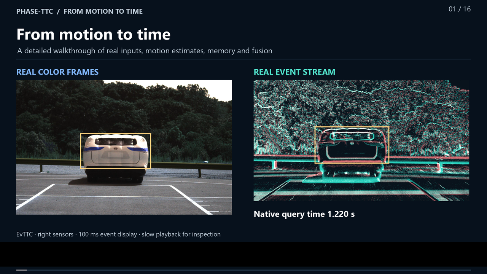

# PHASE-TTC

**Causal Event–RGB Fusion for Time-to-Contact Estimation**

[Paper](https://schwiedop.com/papers/phase-ttc/) ·
[Project website](https://schwiedop.com/PHASE-TTC/) ·
[Leaderboard](https://www.codabench.org/competitions/17289/#/results-tab) ·
[Reproduction guide](docs/reproducibility.md)

<a href="https://huggingface.co/AlvaroSchwiedop/PHASE-TTC"></a> **Hugging Face:** [PHASE-TTC](https://huggingface.co/AlvaroSchwiedop/PHASE-TTC) · [PHASE-TTC-Adapt](https://huggingface.co/AlvaroSchwiedop/PHASE-TTC-Adapt) · [Recorded demo](https://huggingface.co/spaces/AlvaroSchwiedop/PHASE-TTC)

<a href="https://github.com/Kripta-Studios/phase-ttc"></a> [GitHub](https://github.com/Kripta-Studios/phase-ttc) · <a href="https://www.linkedin.com/in/%C3%A1lvaro-schwiedop-souto-92718b339/"></a> [LinkedIn](https://www.linkedin.com/in/%C3%A1lvaro-schwiedop-souto-92718b339/)

PHASE-TTC estimates signed time-to-contact (TTC) from event streams and RGB
frames. Independent motion estimators process each modality; temporal refiners
summarize their causal histories, and a compact residual head corrects an RGB
anchor using phase, timing and observation-support descriptors.

The complete system achieves **35.8015 Overall Motion-in-Depth (MiD) error** on
GarlTTC Test, a **20.49% reduction** relative to the reported Garl-TTC reference
of 45.03, with **0% scorer-defined failures** across **6,762 scored tokens**.
The paper documents **Rank 1** in the archived
leaderboard evaluation. This result measures the complete system; the component
studies below examine which parts account for its performance.

## Paper

**[PHASE-TTC: From Motion to Time](paper/from_motion_to_time_20261102/PHASE_TTC_From_Motion_to_Time_Expanded.pdf)**
describes the architecture, official benchmark result, matched readout controls,
geometric adaptation and execution measurements.

- [Read online](https://schwiedop.com/papers/phase-ttc/)
- [Download the PDF](paper/from_motion_to_time_20261102/PHASE_TTC_From_Motion_to_Time_Expanded.pdf)
- [LaTeX source](paper/from_motion_to_time_20261102/main.tex)
- [Download the source bundle](paper/PHASE_TTC_From_Motion_to_Time_Expanded_sources.zip)
- [Matched-comparison data and protocols](paper/from_motion_to_time_20261102/data/consolidation)
- [Persistent-service evidence](paper/from_motion_to_time_20261102/data/persistent_service_20261112)
- [Persistent PHASE/Garl comparison](paper/from_motion_to_time_20261102/revision/persistent_comparison_report.md)

The PDF contains the main article and a technical supplement with implementation
details, additional experiments and reproduction records. The 12 November update
compares persistent PHASE/Garl services on the same causal EvTTC CPLA-low replay,
with resident models, reusable state and three measured passes per arm. Historical
query-API experiments remain archived separately; their timings are excluded from
the article's deployment-response comparison.

## Architecture

The released base model executes one nine-component inference chain. Training
uses grouped out-of-fold features; inference does not execute an ensemble of
the training folds.

| Components | Role |
|---|---|
| Four motion backbones | Separate transport-trained and coarse-to-fine estimators for RGB and events. |
| Two pairwise readouts | Convert modality-specific pair features and timing into phase estimates. |
| Two temporal refiners | Summarize up to eight observations per modality, within a maximum 650 ms causal information span. |
| One residual fusion head | Combine 20 phase, timing and support descriptors to correct the RGB estimate. |

The complete original system has **2,347,313 parameters**. Its
**1,955-parameter fusion head** contains two hidden layers of width 32 with
LayerNorm and SiLU. This count describes the head, not the full system. The phase
coordinate links apparent scale change to inverse TTC; the output policy
preserves approaching and receding motion and bounds emitted TTC magnitudes.
The 650 ms history describes past information, not inference latency.

Inputs require synchronized event/RGB observations and supplied object regions.
The released estimator does not include an autonomous object detector or
calibrated collision probabilities. The paper specifies the sensor preparation,
timing conventions and signed output policy.

**PHASE-TTC-Adapt** adds causal box-expansion estimates and three quality routers
of 688 parameters each. It keeps the original nine components frozen and
averages the three adapted TTC predictions. This is a separate model with a
local evaluation, not a replacement for the benchmarked submission.

## Results

### Official benchmark

| System | Overall MiD ↓ | Scorer-defined failure rate ↓ |
|---|---:|---:|
| Garl-TTC reference | 45.03 | 0% |
| PHASE-TTC | **35.8015** | **0%** |

The evaluation uses private test labels and 6,762 submission tokens, including
aliases of physical queries. The [scoring records](paper/data/official_benchmark.json)
and paper document the submission, TTC bands and failure criterion. The reported
rank refers to that recorded evaluation; it is not a claim about the live
leaderboard or all published TTC methods.

### Transfer and matched readout controls

The transfer study evaluates 460 eligible queries across 32 recordings.
Released fusion has a mean absolute error of **0.813 s**, compared with
**0.851 s** for the RGB branch. Fusion improves the mean and upper-tail point
estimates, while RGB has lower median and mean relative error. The paired
recording-bootstrap intervals for the mean, median and p95 differences include
zero.

Matched experiments keep upstream models and histories fixed and fit
equal-capacity heads using source-domain features. Each learned variant uses
three seeds.

| Readout | Transfer MAE, mean ± standard deviation ↓ |
|---|---:|
| Phase correction with real events | 0.847 ± 0.038 s |
| Phase correction with zero events | 0.838 ± 0.021 s |
| Inverse-TTC correction with real events | 0.847 ± 0.041 s |
| Source-calibrated scalar phase mixture | 0.996 s |

The learned corrections outperform the tested scalar mixture. These controls
show no consistent incremental advantage from event access or from phase over
inverse-TTC parameterization on this cohort. The recordings had influenced
earlier development, so these comparisons provide component analysis rather
than independent confirmation. The experimental heads do not replace the
released weights.

### Geometric adaptation

The adaptation study separates box geometry from learned routing. All rows
below use the same geometry-valid queries and signed predictions.

| Estimator | MAE: 424 common queries ↓ | MAE: 357 road queries ↓ |
|---|---:|---:|
| Original fusion | 0.793 s | 0.282 s |
| Geometry alone | 1.158 s | 1.343 s |
| Fixed inverse-TTC mixture | **0.289 s** | 0.221 s |
| Learned router | 0.304 s | **0.159 s** |

The router improves road MAE over the fixed mixture by 0.062 s, with a 95%
recording-bootstrap interval of [0.014, 0.120] s. Its pooled advantage is
unresolved: the fixed-minus-router difference is −0.0146 s, with interval
[−0.1704, 0.0943] s. Across all 434 queries, including geometry fallbacks,
original/adapted signed MAE is **0.824/0.347 s**. These development-exposed local
results do not establish a new official adapted score.

### Execution and reproducibility

A five-second, single-object replay paced at 50 Hz completes all **250 updates**
with numerical parity and no drops. Scheduled-arrival response reaches
**29.14 ms at p95**; 201 responses meet or exceed 20 ms. The replay therefore
does not satisfy the 20 ms response deadline. RAW data are preloaded and disk
I/O is excluded. Starting the clock after input preparation still gives a p95
of 25.25 ms, so preparation alone does not explain the missed deadline.

The released head agrees with saved transfer predictions within 2.87 × 10⁻⁶ s
when replayed on recovered features. Full historical inference has a separate
unresolved discrepancy: 504 of 5,805 native-replay queries exceed the original
tolerance, with a maximum TTC difference of 0.4968 s. The archived submission
and official score remain distinct from local reproduction.

## Download and run

The Hugging Face repositories contain frozen weights, normalizers, custom
runtime code, example inputs, evaluation records and training recipes.

| Repository | Contents |
|---|---|
| [PHASE-TTC](https://huggingface.co/AlvaroSchwiedop/PHASE-TTC) | The benchmarked nine-component base system. |
| [PHASE-TTC-Adapt](https://huggingface.co/AlvaroSchwiedop/PHASE-TTC-Adapt) | The base system plus the three-router geometric adaptation. |
| [Demo Space](https://huggingface.co/spaces/AlvaroSchwiedop/PHASE-TTC) | Recorded examples and instructions for local inference. |

Use a fresh **Python 3.12** environment:

```bash
pip install huggingface_hub
hf download AlvaroSchwiedop/PHASE-TTC --local-dir PHASE-TTC
cd PHASE-TTC
pip install -r requirements.txt
python predict.py --input examples/synthetic_looming.npz --verify examples/synthetic_expected.json
python evaluate_saved.py
```

CPU execution is the default; CUDA requires a compatible PyTorch installation.
To run the adapted model, replace both the Hub repository and local directory
with `PHASE-TTC-Adapt`. Pin `hf download --revision <commit>` for repeatable
downloads. The inference scripts verify file checksums before loading weights.

The synthetic example executes the selected inference graph.
`evaluate_saved.py` recomputes published local summaries from saved predictions;
it does not rerun private-label benchmark scoring. For real sensor inputs,
obtain the dataset separately and follow the bundle's `INPUT_FORMAT.md` and
the [reproduction guide](docs/reproducibility.md).

## Research code and data

Install the repository and development tools with `uv`:

```bash
git clone https://github.com/Kripta-Studios/phase-ttc.git
cd phase-ttc
uv sync --locked --all-groups --no-editable
uv run --no-sync phase-ttc --help
```

The research package supports Python 3.11–3.13. The standalone Hub inference
bundles have a tested Python 3.12 environment and their own requirements.

| Directory | Contents |
|---|---|
| `src/e_jepa_ttc/` | Data handling, representations, models, training and evaluation. |
| `operational/final_refit/` | Grouped fitting, final refit and inference procedures. |
| `operational/evttc_competition/` | Sensor preparation and EvTTC inference runtime. |
| `configs/` | Model, data and experiment configurations. |
| `tests/` | Unit, integration and regression checks. |
| `paper/from_motion_to_time_20261102/` | Current article, figures, result tables and build scripts. |

eAP/GarlTTC and EvTTC data must be obtained under their respective terms.
Raw datasets and intermediate training caches are not included in Git.
Full original retraining requires the external data, path configuration and
reconstruction of intermediate caches; a complete retraining has not been
performed as part of the public packaging validation. The adapted bundle
includes derived training features and its fixed three-seed router recipe.
See the [dataset card](docs/dataset_card.md) and
[reproduction guide](docs/reproducibility.md) for requirements.

The final model uses supervised motion estimation and phase fusion. Predictive
JEPA experiments form part of the supplementary research; they did not establish
a pretraining benefit in the tested settings. Existing checkpoints and scripts
retain the `e_jepa_ttc` import namespace and compatible `e-jepa-ttc` command.

Run the repository checks with:

```bash
uv run --no-sync ruff check .
uv run --no-sync ruff format --check .
uv run --no-sync pyright
uv run --no-sync pytest -q
```

## Build the paper

From the repository root:

```bash
python paper/from_motion_to_time_20261102/scripts/build_expanded.py
python paper/from_motion_to_time_20261102/scripts/verify_publication.py
python paper/from_motion_to_time_20261102/scripts/package_expanded.py
```

The build requires NumPy, Matplotlib, Pillow, PyMuPDF, pdfLaTeX and BibTeX,
including the XCharter, newtxmath and TikZ packages. It regenerates result tables
from the accompanying evidence and checks that the compiled PDF matches its
source inputs. The packager writes the PDF, consolidated LaTeX and source ZIP
to `output/pdf/`.

## Architecture video

[](https://github.com/Kripta-Studios/phase-ttc/releases/download/phase-ttc-architecture-video-20261111-rank1/PHASE_TTC_Architecture_260s_1080p.mp4)

**[Watch or download: 4:20, 1080p, 60 fps](https://github.com/Kripta-Studios/phase-ttc/releases/download/phase-ttc-architecture-video-20261111-rank1/PHASE_TTC_Architecture_260s_1080p.mp4)** ·
[English subtitles](https://github.com/Kripta-Studios/phase-ttc/releases/download/phase-ttc-architecture-video-20261111-rank1/PHASE_TTC_Detailed_EN.srt)

The narrated walkthrough follows real EvTTC observations through preprocessing,
motion estimation, temporal refinement and signed TTC prediction. Connected
diagrams distinguish expert values, routing weights and the RGB residual anchor.
The closing sections present the current matched readout controls, signed
geometric-adaptation results and measured execution limits.

## Scope and limitations

PHASE-TTC is a research estimator for supplied object regions. The official
complete-system result does not isolate the benefit of the phase interface,
event inputs or temporal history. Secondary studies reuse recordings inspected
during development, and additional head seeds share upstream models.

Independent transfer validation, reconciliation of the Slider-750 evaluator
discrepancy and historical inference parity remain open. Sustained physical-camera
operation, autonomous localization, multiobject latency and calibrated warning
probabilities are outside the demonstrated result. The system is not validated
for safety-critical control.

## Citation and license

**Álvaro Schwiedop Souto** · University of Santiago de Compostela

Please cite the [paper](https://schwiedop.com/papers/phase-ttc/) and use
[CITATION.cff](CITATION.cff) for software citation metadata. Pin the repository
and model revisions used in experiments. Code and released weights use the
[MIT license](LICENSE); external datasets retain their own licenses.

```bibtex
@misc{schwiedop2026phasettc,
  title = {PHASE-TTC: From Motion to Time -- Causal Event--RGB Fusion for Signed Time-to-Contact Estimation},
  author = {Schwiedop Souto, {\'A}lvaro},
  year = {2026},
  howpublished = {Research preprint},
  url = {https://schwiedop.com/papers/phase-ttc/}
}
```

[Email](mailto:alvaro@schwiedop.com) ·
[Website](https://schwiedop.com/PHASE-TTC/) ·
[LinkedIn](https://www.linkedin.com/in/%C3%A1lvaro-schwiedop-souto-92718b339/) ·
[Model card](docs/model_card.md)
