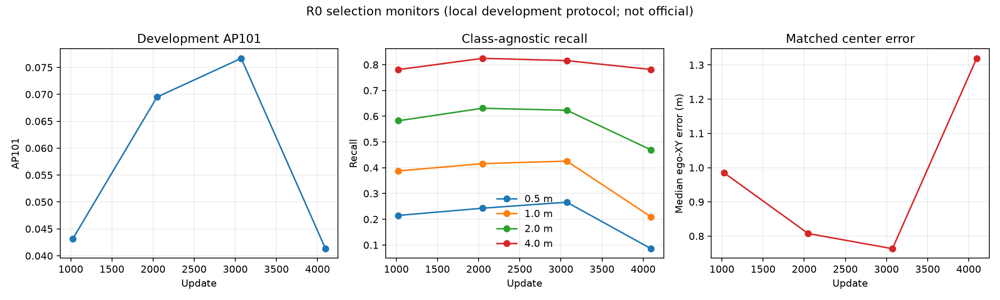

> **Instantánea histórica anterior al cierre de R0/R2; no es el estado actual.**
> Se conserva como registro de seguimiento. Para resultados posteriores, véanse
> [la decisión R0/R2](R0_R2_SEED7_DECISION.md) y
> [el estado del 2 de noviembre](ESTADO_RESULTADOS_Y_ARTEFACTOS_EAP_20261102.md).

# Curva de monitores R0

Los cuatro puntos usan el mismo protocolo, población y soporte. Son AP101 de desarrollo, no puntuaciones oficiales ni métricas TTC.
La evaluación separada sobre los 23.958 frames de selección completa sigue en ejecución y no se incluye en esta curva.

| Update | AP101 | Recall 0,5 m | Recall 1 m | Recall 2 m | Recall 4 m | Mediana error ego-XY |
|---:|---:|---:|---:|---:|---:|---:|
| 1024 | 0.04313690 | 0.214917 | 0.387584 | 0.582453 | 0.780987 | 0.985203 m |
| 2048 | 0.06949554 | 0.242940 | 0.416038 | 0.630955 | 0.824747 | 0.807535 m |
| 3072 | 0.07669187 | 0.266221 | 0.425738 | 0.623195 | 0.815909 | 0.763284 m |
| 4096 | 0.04131542 | 0.085794 | 0.209097 | 0.469282 | 0.781418 | 1.319315 m |

## AP por clase y soporte fijo

| Clase | GT elegible | AP@1024 | AP@2048 | AP@3072 | AP@4096 | Delta 3072→4096 |
|---|---:|---:|---:|---:|---:|---:|
| car | 2524 | 0.281721 | 0.443292 | 0.483919 | 0.268599 | -0.215320 |
| bicycle | 26 | 0.000000 | 0.000000 | 0.008730 | 0.001650 | -0.007080 |
| truck | 619 | 0.022857 | 0.045491 | 0.046180 | 0.015719 | -0.030461 |
| pedestrian | 338 | 0.000000 | 0.005082 | 0.000403 | 0.006727 | +0.006323 |
| motorcycle | 963 | 0.040516 | 0.057766 | 0.052464 | 0.021571 | -0.030893 |
| bus | 85 | 0.000000 | 0.000000 | 0.016799 | 0.007966 | -0.008833 |
| tricycle | 80 | 0.000000 | 0.004333 | 0.005039 | 0.008292 | +0.003253 |
| other_vehicle | 4 | 0.000000 | 0.000000 | 0.000000 | 0.000000 | +0.000000 |

## Errores de los matches diagnósticos

`ego-Z` es altura en coordenadas ego, no profundidad de cámara. Los errores de dimensiones resumen la mediana del promedio absoluto L/W/H por match.

| Update | Matches | Ego-XY mediana | Ego-Z mediana | Dimensiones mediana | Yaw mediana |
|---:|---:|---:|---:|---:|---:|
| 1024 | 2235 | 0.985203 m | 0.051441 m | 0.133072 m | 0.043823 rad |
| 2048 | 2418 | 0.807535 m | 0.046389 m | 0.110809 m | 0.071911 rad |
| 3072 | 2307 | 0.763284 m | 0.044968 m | 0.096369 m | 0.049282 rad |
| 4096 | 1711 | 1.319315 m | 0.064255 m | 0.135248 m | 0.039046 rad |

## Lectura acotada

Entre 3072 y 4096 la AP baja -0.03537645. La recall class-agnostic cae especialmente a 0,5 m (-0.180427) y 1 m (-0.216642); la mediana de error ego-XY pasa de 0.763284 m a 1.319315 m.

El patrón geométrico observado más fuerte es la degradación de localización del centro; `car` aporta la mayor caída absoluta de AP. Sin embargo, la recall class-agnostic reportada depende del orden por score y los matches diagnósticos también proceden de ese resultado: estos cuatro monitores no separan geometría de ranking. La evidencia orienta primero a inspeccionar geometría/localización, sin excluir ranking ni identificar por sí sola la causa de entrenamiento.

Un único punto inferior no demuestra sobreajuste. El punto 4096 procede del fallback original reanudado desde el checkpoint durable 3840; las 228 actualizaciones/912 exposiciones de la cola detenida están excluidas. El cambio de GPU/runtime puede introducir no determinismo, por lo que la línea no se presenta como una continuación bit-exacta.



Regeneración:

```powershell
python scripts/build_r0_monitor_curve.py --update4096 <SELECTION_UPDATE_4096_JSON>
```

La [proyección numérica conservada](evidence/pending_candidates_20261102/detection_campaign/r0_monitor_curve_v1/summary.json) y su CSV acompañan la imagen. Regenerar desde las evaluaciones completas requiere los artefactos locales indicados en sus referencias; no se incluyen en este archivo histórico.
