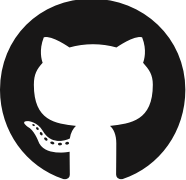

# PHASE-TTC-Adapt

PHASE-TTC estimates signed time-to-contact (TTC) from causal event-camera observations and RGB frames. It measures motion independently in each modality, refines those measurements over time, and combines them in a physical phase representation with a correction anchored in RGB.

[Paper and interactive reader](https://schwiedop.com/papers/phase-ttc/) · [Project](https://schwiedop.com/PHASE-TTC/) · [Code](https://github.com/Kripta-Studios/phase-ttc) · [Official leaderboard](https://www.codabench.org/competitions/17289/#/results-tab) · [Explore recorded examples](https://huggingface.co/spaces/AlvaroSchwiedop/PHASE-TTC)

## EvTTC adaptation

This repository releases **PHASE-TTC-Adapt-20261031**. It contains the exact frozen [original nine-component model](https://huggingface.co/AlvaroSchwiedop/PHASE-TTC) plus a three-seed ensemble of 688-parameter quality routers. The adapter combines native TTC estimates with causal bounding-box expansion in inverse-TTC coordinates. It returns to the native estimate when suitable geometric history is unavailable.

The routers were fitted on **2,608 development queries**: 2,531 road queries from 24 recordings and 77 Slider-500 queries. The ten evaluation recordings were excluded from that final fit, although the dataset and earlier model development were exposed. Subsequent refits failed their controls and do not replace this frozen release.

On the separate **434-query local EvTTC evaluation**, original/adapted pooled MAE is **0.82498 / 0.33590 s**, and relative absolute error is **49.894 / 17.250%**, under organizer-style offline negative-output interpolation. That postprocessing can use future outputs and is separate from causal inference. Nine sequence scores reconstruct the organizer's rounded original results; Slider-750 remains discrepant. **There is no verified official leaderboard score for this adaptation.** The original GarlTTC score is provided as provenance, not as an adapted-model result.

[Original PHASE-TTC result on the official GarlTTC leaderboard](https://www.codabench.org/competitions/17289/#/results-tab): first of three entries, **35.80145 Overall MiD**, in the 28 October 2026 record. This result belongs to the original model. As observed on 18 November 2026, the leaderboard showed one entry per participant and listed instead the account's pre-registered geometry variant without event inputs (PHASE-TTC-Geo: 23.47 Overall MiD, first of three entries), a different head that is neither this adapter nor the original weights; see the [PHASE-TTC card](https://huggingface.co/AlvaroSchwiedop/PHASE-TTC) and [archived evidence at public commit `90040a1b`](https://github.com/Kripta-Studios/phase-ttc/tree/90040a1b1de5f76d26bdc2c2491ff013d4a2ea1c/docs/sota_20261118). Endpoint replay reproduces the geometry submission ZIP byte for byte. A bounded media replay covers 12/5,805 physical queries, one per sequence, but retains the frozen public event tensor; it passes the endpoint gate on 0/12 and the geometry-TTC gate on 5/12, so it is not end-to-end parity. The [versioned lineage and reproduction bundle](https://github.com/Kripta-Studios/phase-ttc/tree/8fa8dda64bcdf846331191eb4ad4c8171b979699/docs/sota_20261121) records that scope. These checks do not alter this adapter's scope or supply it with an official score.

The account history also records a third submission on 21 November 2026: box-only comparator `1063261` scores **27.97563 Overall MiD**, versus **23.47238** for RGB + geometry, a **4.50325-point gap**. Its crucial / small / large / negative bands are **26.38540 / 28.00007 / 32.93790 / 30.89121**, versus **24.36932 / 23.95223 / 22.89423 / 18.12626**. Both heads use supplied-region history; only the better system adds RGB-branch estimates. Neither is this adaptation. This is a within-account protocol comparison, not a comparison between companies or matched end-to-end sensor systems. The public leaderboard display after the third submission has not been archived. [Record and lineage at public commit `8fa8dda6`](https://github.com/Kripta-Studios/phase-ttc/tree/8fa8dda64bcdf846331191eb4ad4c8171b979699/docs/sota_20261121).


<a href="https://github.com/Kripta-Studios/phase-ttc"></a> [GitHub](https://github.com/Kripta-Studios/phase-ttc) · <a href="https://www.linkedin.com/in/%C3%A1lvaro-schwiedop-souto-92718b339/"></a> [LinkedIn](https://www.linkedin.com/in/%C3%A1lvaro-schwiedop-souto-92718b339/)

## Qualification boundary

Projection from the published TRAIN40 annotations reproduced **88,744/88,744 integer boxes** (median pre-truncation IoU 0.9878; p95 maximum edge error 0.987 px). This validates projection from supplied annotations, not an autonomous detector. On **597 development-exposed FCWD queries**, robust geometry plus event content scale records **16.1% relative TTC error**, versus **26.8%** for the public Garl-TTC event model run locally; the protocols are not matched, this is not independent generalization, and this FCWD model is distinct from submissions `1058935` and `1063261`. On 600 TRAIN40 queries, isolated p95 compute is **36.22 ms** for the official RGB + geometry model on GPU, **0.98 ms** for the box-only model on CPU and **83.79 ms** for robust geometry + event content scale on CPU, with prior history cached. Reading, queueing and input production are excluded, so these are not end-to-end latency claims. [Box audit, FCWD table and isolated-latency evidence](https://github.com/Kripta-Studios/phase-ttc/tree/8fa8dda64bcdf846331191eb4ad4c8171b979699/docs/sota_20261121).

## Download and run

Use Python 3.12 and a fresh environment. Install the Hugging Face CLI (`pip install huggingface_hub`) if needed, then:

```bash
hf download AlvaroSchwiedop/PHASE-TTC-Adapt --local-dir PHASE-TTC-Adapt
cd PHASE-TTC-Adapt
python -m pip install -r requirements.txt
python predict.py --input examples/synthetic_looming.npz --verify examples/synthetic_expected.json
```

The example executes the supplied weights on synthetic expanding shapes. Its reference output tests software execution; it is not a benchmark accuracy measurement. CPU is the default. For CUDA, install the appropriate PyTorch 2.10.0 / torchvision 0.25.0 wheels and add `--device cuda`.

For a CPU-only installation, install PyTorch first from `https://download.pytorch.org/whl/cpu`. `requirements-cpu-tested.txt` records the versions tested on Windows with Python 3.12. Platform-specific wheels may differ on Linux.

`predict.py` verifies the SHA-256 manifest, loads the custom PyTorch graph and prints TTC in seconds. Download a specific Hub revision with `--revision <commit>` to keep an experiment fixed. This is a custom sensor model; `transformers.AutoModel` is not its loader.

## Try real observations

Obtain the [EvTTC benchmark data](https://nail-hnu.github.io/EvTTC/download/download/) separately. Keep its sequence directory names and calibration files. From this model directory:

```bash
python extract_example.py --data-root /path/to/EvTTC-Benchmark --sequence CCRm-low --row 10 --output real_input.npz
python predict.py --input real_input.npz --verify examples/real_CCRm_low_row10_expected.json
```

The second command checks the recorded query at 520329 microseconds; use the same benchmark sequence and row. Other queries should omit `--verify`. Raw sensor data stays on your machine. Inputs contain pixels, timestamps and supplied object regions, with no TTC labels. See [INPUT_FORMAT.md](INPUT_FORMAT.md) for custom inputs and sensor assumptions.

## What is included

- Exact checkpoints, normalizers, original seals and model recipe in `model/`.
- Runtime dependencies in `source/`, inference and extraction commands, and a synthetic input.
- Expected outputs and validation receipt in `examples/` and `VALIDATION.json`.
- Saved evaluation projections, labels, source identities and a metric recomputation command in `evaluation/`.
- A research source archive and the training/reproduction boundaries described in [REPRODUCTION.md](REPRODUCTION.md).

Historical identifiers and seals preserve their original bytes. Their old paths or status flags describe their creation, not the current release status. `RELEASE.json`, this card and `MANIFEST.json` describe this release. Auxiliary research modules imported by the runtime do not change the selected model.

## Scope and limitations

The model expects synchronized, calibrated event/RGB observations and supplied object regions. An autonomous detector is a separate component. The release exposes signed TTC and diagnostics; it does not provide calibrated collision probabilities or uncertainty intervals. The published paced replay measured 29.14 ms p95 over 250 updates, above a 20 ms budget. That experiment does not demonstrate sustained 50 Hz sensor-to-output operation.

The corrected EvTTC transfer cohort contains 460 eligible queries from 508 fixed candidates across 32 development-exposed sequences. Original fusion improves pooled MAE (0.8130 s versus RGB's 0.8513 s) and p95 error, while RGB has better median and relative error. Sequence-level paired confidence intervals include zero. These transfer data and the separate 434-query adaptation evaluation have different denominators and protocols.

JEPA experiments belong to the research history; the released final model is the phase-fusion system described above. No safety certification or deployment guarantee is implied by a zero benchmark failure rate.

## License and citation

Project code and model release: MIT, see [LICENSE](LICENSE). Obtain external datasets under their own terms; raw datasets are not bundled. [CITATION.cff](CITATION.cff) identifies the software and author. The paper is available from the links above.
