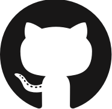

# PHASE-TTC

PHASE-TTC estimates signed time-to-contact (TTC) from causal event-camera observations and RGB frames. It measures motion independently in each modality, refines those measurements over time, and combines them in a physical phase representation with a correction anchored in RGB.

[Paper and interactive reader](https://schwiedop.com/papers/phase-ttc/) · [Project](https://schwiedop.com/PHASE-TTC/) · [Code](https://github.com/Kripta-Studios/phase-ttc) · [Official leaderboard](https://www.codabench.org/competitions/17289/#/results-tab) · [Explore recorded examples](https://huggingface.co/spaces/AlvaroSchwiedop/PHASE-TTC)

## Original nine-component model

This repository releases the frozen **PHASE_ONLY_EVENT_S7_TRAIN40_SCIENTIFIC_OOF** system. Its nine components are four modality-specific motion backbones, two pairwise temporal readouts, two temporal refiners and one 1,955-parameter phase fusion head. The head's size is not the size of the complete model. Up to 650 ms of causal information is admitted.

The original model ranked **first of three entries** in the archived **[GarlTTC Test leaderboard](https://www.codabench.org/competitions/17289/#/results-tab), recorded on 28 October 2026**: **35.80145 Overall MiD**, compared with **45.03** for Garl-TTC, a **20.49% reduction** over 6,762 scored tokens with **0% scorer-defined failures**. The tokens include 5,805 physical queries and aliases. These are archived official results, not a claim about today's leaderboard or a new evaluation of this release. The other two entries are the organizers' Garl-TTC reference and an unnamed submission with the same score. PHASE-TTC uses up to 650 ms of causal history and the benchmark's supplied object regions, whereas Garl-TTC uses two observations 0.1 s apart. The result measures the complete system: matched controls in the paper do not show a benefit from event access or from the phase parameterization, so the gain is not attributed to event-RGB fusion. The scored upload is verified: the file retrieved from the CodaBench record of that submission (1016512) has SHA-256 `5eb69749de7aff68…`, identical to the retained TRAIN40 prediction package of this system, and its scoring record reports 35.80145 Overall MiD.

The separately distributed [PHASE-TTC-Adapt](https://huggingface.co/AlvaroSchwiedop/PHASE-TTC-Adapt) adds an EvTTC-trained geometric quality router. It is not the model associated with this official score.

**Second submission, 18 November 2026 (not these weights).** A pre-registered geometry variant was submitted once to the same test server (submission 1058935): a head that receives the RGB-branch estimates and the causal expansion of the supplied object regions, with a band-weighted loss and **no event inputs**. It scores **23.47 Overall MiD** (crucial / small / large / negative bands 24.37 / 23.95 / 22.89 / 18.13, 0% scorer-defined failures), 34% below this model's 35.80 and 48% below Garl-TTC's 45.03. It uses the same supplied object regions and a 600 ms box history, and the file retrieved from its CodaBench record matches the pre-registered package (SHA-256 `8590f1151bb8b8db…`). This variant is a different head and is **not** the weights released in this repository. Its result indicates that most of the accuracy available on this benchmark comes from the history of the supplied regions, and that the event branch is not needed to obtain it. Protocol, receipts, scoring records and the submission ledger: [archived evidence at public commit `90040a1b`](https://github.com/Kripta-Studios/phase-ttc/tree/90040a1b1de5f76d26bdc2c2491ff013d4a2ea1c/docs/sota_20261118).

**Third submission, 21 November 2026 (not these weights).** Submission `1063261` is a box-only head using 600 ms of supplied-region history, with no image or event model. It scores **27.97563 Overall MiD** with 0% scorer-defined failures; crucial / small / large / negative bands are **26.38540 / 28.00007 / 32.93790 / 30.89121**. The RGB + geometry submission remains better at **23.47238**, a **4.50325-point gap**, and is better in all four bands (**24.36932 / 23.95223 / 22.89423 / 18.12626**). This isolates the contribution of RGB-branch estimates beyond their shared supplied-box history. It is a protocol comparison between two heads from the same account, not a company-level comparison or a matched end-to-end sensor benchmark. The public leaderboard display after the third submission has not been archived, so no current rank is claimed. [Submission record and ledger](https://github.com/Kripta-Studios/phase-ttc/tree/8fa8dda64bcdf846331191eb4ad4c8171b979699/docs/sota_20261118).

As observed on 18 November 2026, before the third submission, the leaderboard showed one entry per participant and listed the geometry variant (as PHASE-TTC-Geo: 23.47, first of three entries) instead of the 35.80 entry of this model, which survives in the archived 28 October record. The display policy after submission `1063261` is unknown.

**Reproduction status, 21 November 2026.** Replay from the frozen PHASE20 endpoints reproduces all 5,805 physical queries and the submitted ZIP byte for byte. Refitting the geometry head from those authenticated endpoint inputs reproduces every seed-7 physical prediction; seeds 13 and 21 show unstable tails. A bounded media replay covers 12/5,805 physical queries, one per sequence: it regenerates RGB from retained media but reuses the frozen public event tensor. It passes the `1e-6` endpoint gate on 0/12 queries and the `1e-4 s` geometry-TTC gate on 5/12 (median/max drift `1.893e-4/8.430e-4 s`), so it is not end-to-end parity. These checks read no private targets and do not produce a new private Overall score. A CSV-only repackage does not preserve the original ZIP bytes. See the [versioned lineage and reproduction bundle](https://github.com/Kripta-Studios/phase-ttc/tree/8fa8dda64bcdf846331191eb4ad4c8171b979699/docs/sota_20261121).

[View the official leaderboard on Codabench →](https://www.codabench.org/competitions/17289/#/results-tab)


<a href="https://github.com/Kripta-Studios/phase-ttc"></a> [GitHub](https://github.com/Kripta-Studios/phase-ttc) · <a href="https://www.linkedin.com/in/%C3%A1lvaro-schwiedop-souto-92718b339/"></a> [LinkedIn](https://www.linkedin.com/in/%C3%A1lvaro-schwiedop-souto-92718b339/)

## Qualification boundary

Projection from the published TRAIN40 annotations reproduced **88,744/88,744 integer boxes** (median pre-truncation IoU 0.9878; p95 maximum edge error 0.987 px). This validates projection from supplied annotations, not an autonomous detector. On **597 development-exposed FCWD queries**, robust geometry plus event content scale records **16.1% relative TTC error**, versus **26.8%** for the public Garl-TTC event model run locally; the protocols are not matched, this is not independent generalization, and this FCWD model is distinct from submissions `1058935` and `1063261`. On 600 TRAIN40 queries, isolated p95 compute is **36.22 ms** for the official RGB + geometry model on GPU, **0.98 ms** for the box-only model on CPU and **83.79 ms** for robust geometry + event content scale on CPU, with prior history cached. Reading, queueing and input production are excluded, so these are not end-to-end latency claims. [Box audit, FCWD table and isolated-latency evidence](https://github.com/Kripta-Studios/phase-ttc/tree/8fa8dda64bcdf846331191eb4ad4c8171b979699/docs/sota_20261121).

## Download and run

Use Python 3.12 and a fresh environment. Install the Hugging Face CLI (`pip install huggingface_hub`) if needed, then:

```bash
hf download AlvaroSchwiedop/PHASE-TTC --local-dir PHASE-TTC
cd PHASE-TTC
python -m pip install -r requirements.txt
python predict.py --input examples/synthetic_looming.npz --verify examples/synthetic_expected.json
```

The example executes the supplied weights on synthetic expanding shapes. Its reference output tests software execution; it is not a benchmark accuracy measurement. CPU is the default. For CUDA, install the appropriate PyTorch 2.10.0 / torchvision 0.25.0 wheels and add `--device cuda`.

For a CPU-only installation, install PyTorch first from `https://download.pytorch.org/whl/cpu`. `requirements-cpu-tested.txt` records the versions tested on Windows with Python 3.12. Platform-specific wheels may differ on Linux.

`predict.py` verifies the SHA-256 manifest, loads the custom PyTorch graph and prints TTC in seconds. Download a specific Hub revision with `--revision <commit>` to keep an experiment fixed. This is a custom sensor model; `transformers.AutoModel` is not its loader.

## Try real observations

Obtain the [EvTTC benchmark data](https://nail-hnu.github.io/EvTTC/download/download/) separately. Keep its sequence directory names and calibration files. From this model directory:

```bash
python extract_example.py --data-root /path/to/EvTTC-Benchmark --sequence CCRm-low --row 10 --output real_input.npz
python predict.py --input real_input.npz --verify examples/real_CCRm_low_row10_expected.json
```

The second command checks the recorded query at 520329 microseconds; use the same benchmark sequence and row. Other queries should omit `--verify`. Raw sensor data stays on your machine. Inputs contain pixels, timestamps and supplied object regions, with no TTC labels. See [INPUT_FORMAT.md](INPUT_FORMAT.md) for custom inputs and sensor assumptions.

## What is included

- Exact checkpoints, normalizers, original seals and model recipe in `model/`.
- Runtime dependencies in `source/`, inference and extraction commands, and a synthetic input.
- Expected outputs and validation receipt in `examples/` and `VALIDATION.json`.
- Saved evaluation projections, labels, source identities and a metric recomputation command in `evaluation/`.
- A research source archive and the training/reproduction boundaries described in [REPRODUCTION.md](REPRODUCTION.md).

Historical identifiers and seals preserve their original bytes. Their old paths or status flags describe their creation, not the current release status. `RELEASE.json`, this card and `MANIFEST.json` describe this release. Auxiliary research modules imported by the runtime do not change the selected model.

## Scope and limitations

The model expects synchronized, calibrated event/RGB observations and supplied object regions. An autonomous detector is a separate component. The release exposes signed TTC and diagnostics; it does not provide calibrated collision probabilities or uncertainty intervals. The published paced replay measured 29.14 ms p95 over 250 updates, above a 20 ms budget. That experiment does not demonstrate sustained 50 Hz sensor-to-output operation.

The corrected EvTTC transfer cohort contains 460 eligible queries from 508 fixed candidates across 32 development-exposed sequences. Original fusion improves pooled MAE (0.8130 s versus RGB's 0.8513 s) and p95 error, while RGB has better median and relative error. Sequence-level paired confidence intervals include zero. These transfer data and the separate 434-query adaptation evaluation have different denominators and protocols.

JEPA experiments belong to the research history; the released final model is the phase-fusion system described above. No safety certification or deployment guarantee is implied by a zero benchmark failure rate.

## License and citation

Project code and model release: MIT, see [LICENSE](LICENSE). Obtain external datasets under their own terms; raw datasets are not bundled. [CITATION.cff](CITATION.cff) identifies the software and author. The paper is available from the links above.
